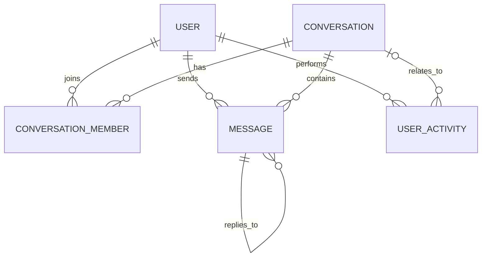

# Đặc tả dữ liệu và luồng hệ thống

## 1. Mục đích và phạm vi

Tài liệu mô hình dữ liệu và các luồng chính cho `sa_zalo_ott_service`. Đây là thiết kế mục tiêu, **chưa có nghĩa các chức năng đã được triển khai**.

Stack mục tiêu hiện có là React ở frontend và NestJS + GraphQL + MongoDB ở backend. GraphQL xử lý dữ liệu nghiệp vụ; tệp nhị phân được lưu ở dịch vụ lưu trữ tệp, MongoDB chỉ giữ metadata. Có thể bổ sung Socket.IO sau khi các luồng chat cơ bản đã hoạt động qua API.

## 2. Quy tắc và quyết định dữ liệu

- Dùng MongoDB ObjectId làm ID nội bộ; thời gian lưu dưới dạng UTC.
- Backend là nguồn dữ liệu chính. Frontend không dùng `localStorage` làm nguồn sự thật cho tài khoản, nhóm hoặc tin nhắn.
- Tài khoản không bị xóa cứng khi cần ngừng sử dụng; đổi `status` sang `disabled` để giữ lịch sử và số liệu.
- Cuộc trò chuyện riêng có đúng hai thành viên và chỉ có một cuộc trò chuyện cho mỗi cặp tài khoản.
- Nhóm có một chủ nhóm (`owner`), có thể có quản trị viên (`admin`) và thành viên (`member`).
- Tin nhắn và sự kiện nhóm đã lưu không bị xóa vật lý khi người dùng thu hồi/xóa; dùng trạng thái xóa để giữ tính toàn vẹn lịch sử.
- Không ghi nội dung tin nhắn, mật khẩu, token hoặc URL tải xuống có chữ ký vào nhật ký hoạt động.
- Chỉ lưu URL/key của tệp trong database; nội dung tệp nằm ngoài MongoDB.

## 3. Mô hình dữ liệu

### `users` — tài khoản

| Trường | Kiểu/ý nghĩa |
|---|---|
| `_id` | ObjectId |
| `email` | Email đăng nhập, chuẩn hóa chữ thường, duy nhất |
| `passwordHash` | Hash mật khẩu; không trả về qua GraphQL |
| `displayName` | Tên hiển thị |
| `avatarUrl` | URL ảnh đại diện, tùy chọn |
| `status` | `active` hoặc `disabled` |
| `createdAt`, `updatedAt` | Thời điểm tạo/cập nhật |
| `lastSeenAt` | Hoạt động gần nhất, tùy chọn |

Mật khẩu thô không bao giờ được lưu. Việc đăng nhập/đăng ký phải kiểm tra trạng thái tài khoản.

### `conversations` — cuộc trò chuyện

| Trường | Kiểu/ý nghĩa |
|---|---|
| `_id` | ObjectId |
| `type` | `direct` hoặc `group` |
| `title` | Tên nhóm; không bắt buộc với chat riêng |
| `createdBy` | ID tài khoản tạo |
| `directKey` | Chỉ dùng cho chat riêng: hai user ID đã sắp xếp và ghép thành khóa ổn định |
| `lastMessageAt` | Thời điểm tin nhắn gần nhất, phục vụ sắp xếp danh sách |
| `createdAt`, `updatedAt` | Thời điểm tạo/cập nhật |
| `closedAt` | Tùy chọn; thời điểm nhóm/cuộc trò chuyện đóng |

Index duy nhất trên `directKey` bảo đảm không tạo trùng chat riêng. Chat nhóm không có `directKey`.

### `conversationMembers` — thành viên và trạng thái đọc

| Trường | Kiểu/ý nghĩa |
|---|---|
| `_id` | ObjectId |
| `conversationId`, `userId` | Tham chiếu cuộc trò chuyện và tài khoản |
| `role` | `owner`, `admin`, `member` |
| `status` | `active`, `left`, `removed` |
| `joinedAt`, `leftAt` | Lịch sử tham gia/rời nhóm |
| `lastReadAt` | Mốc đã đọc gần nhất của tài khoản trong cuộc trò chuyện |

Một user chỉ có một bản ghi thành viên cho một conversation. Chat riêng dùng role `member`; nhóm luôn có đúng một `owner` đang hoạt động. Tách membership khỏi conversation để truy vấn danh sách chat và trạng thái đọc theo tài khoản.

### `messages` — tin nhắn

| Trường | Kiểu/ý nghĩa |
|---|---|
| `_id` | ObjectId |
| `conversationId`, `senderId` | Cuộc trò chuyện và người gửi |
| `kind` | `text`, `image`, `video`, `document`, `system` |
| `text` | Nội dung text; bắt buộc với `text`, tùy chọn với loại khác |
| `attachments` | Danh sách metadata tệp đính kèm, có thể rỗng |
| `replyToId` | ID tin nhắn được trả lời, tùy chọn |
| `createdAt`, `updatedAt` | Thời điểm gửi/cập nhật |
| `deletedAt`, `deletedBy` | Trạng thái thu hồi/xóa, tùy chọn |

Metadata mỗi attachment gồm `storageKey`, `originalName`, `mimeType`, `sizeBytes` và `uploadedAt`. Không nhận `storageKey` tùy ý từ client; backend tạo key sau khi xác thực tệp. Giới hạn kích thước, MIME thực và quyền truy cập phải được kiểm tra ở backend.

Emoji reaction không phải tin nhắn riêng: lưu reaction theo message với `userId`, `emoji`, `createdAt`; mỗi user có tối đa một reaction cho mỗi message ở MVP. Thêm/xóa reaction cập nhật cùng message.

Ràng buộc: `text` phải có nội dung sau khi trim đối với tin nhắn `text`; loại tệp phải khớp `kind`; sender phải là thành viên `active` của conversation.

### `userActivities` — nhật ký hoạt động phục vụ thống kê

| Trường | Kiểu/ý nghĩa |
|---|---|
| `_id` | ObjectId |
| `actorId` | Tài khoản thực hiện |
| `type` | Loại hoạt động trong danh sách cho phép |
| `conversationId`, `targetUserId` | Tham chiếu tùy chọn, tùy loại sự kiện |
| `metadata` | Dữ liệu tổng hợp an toàn, không có nội dung tin nhắn/secret |
| `occurredAt` | Thời điểm UTC |

Loại sự kiện MVP: `login.succeeded`, `account.created`, `conversation.created`, `group.member_added`, `group.member_removed`, `message.sent`, `message.reaction_added`, `message.deleted`, `file.uploaded`. Chỉ ghi sự kiện sau khi thao tác tương ứng thành công. Không tạo sự kiện `message.sent` riêng cho cả từng tệp lẫn tin nhắn chứa tệp; `file.uploaded` là sự kiện riêng để thống kê lưu lượng media.

## 4. Quan hệ

## 5. Index và truy vấn cần hỗ trợ

- `users`: unique index trên `email`.
- `conversations`: unique sparse index trên `directKey`; index trên `lastMessageAt`.
- `conversationMembers`: unique compound index `{ conversationId, userId }`; index `{ userId, status, conversationId }` để tải danh sách chat của user.
- `messages`: compound index `{ conversationId, createdAt, _id }` để phân trang tin nhắn theo thứ tự ổn định; index `senderId` khi cần lọc thống kê.
- `userActivities`: compound index `{ occurredAt, type }` và `{ actorId, occurredAt }`. Có thể thêm TTL/archive policy sau khi chốt thời gian lưu log.

Danh sách hội thoại và tin nhắn phải phân trang; không tải toàn bộ lịch sử lên một lần.

## 6. Luồng nghiệp vụ

### Tài khoản

1. Client gửi đăng ký/đăng nhập qua API.
2. Backend chuẩn hóa email, kiểm tra tài khoản và hash mật khẩu.
3. Backend trả thông tin tài khoản công khai và phiên/token; không trả `passwordHash`.
4. Đăng nhập thành công ghi `login.succeeded`; tài khoản `disabled` bị từ chối.

### Mở chat riêng

1. Client yêu cầu mở chat với một user khác.
2. Backend xác thực hai tài khoản, sắp xếp hai ID tạo `directKey`, tìm hoặc tạo conversation.
3. Backend tạo hai membership nếu conversation mới.
4. Client tải thông tin conversation và tin nhắn theo trang.

### Tạo nhóm và quản lý thành viên

1. Client gửi tên nhóm và danh sách thành viên.
2. Backend xác thực người tạo và các thành viên, tạo conversation `group`, membership `owner` cho người tạo và `member` cho các user còn lại.
3. Thêm/xóa thành viên phải kiểm tra quyền `owner`/`admin`; thay đổi thành viên cập nhật membership và ghi activity.
4. Rời nhóm đổi status membership thành `left`; chuyển chủ nhóm phải chỉ định owner mới trước khi owner hiện tại rời.

### Gửi tin nhắn text/reaction

1. Client gửi conversation ID, nội dung và khóa idempotency tùy chọn.
2. Backend xác thực phiên, tư cách thành viên, nội dung và quyền thao tác.
3. Backend ghi message và cập nhật `lastMessageAt`; ghi activity sau khi thành công.
4. Backend trả message đã lưu. Khi bật realtime, phát sự kiện Socket.IO **sau khi lưu** tới thành viên đang kết nối.
5. Reaction được xác thực và upsert theo cặp message/user; gỡ reaction cũng qua backend.

### Gửi image/video/document

1. Client yêu cầu quyền tải lên cho conversation và gửi tệp.
2. Backend xác thực thành viên, dung lượng, loại nội dung; tải tệp lên object storage và nhận `storageKey`.
3. Backend tạo message với `kind` tương ứng và attachment metadata, rồi ghi activity.
4. Nếu lưu message thất bại sau upload, backend xóa object vừa tạo hoặc đưa vào quy trình dọn tệp mồ côi.
5. Khi tải/xem tệp, backend kiểm tra quyền thành viên trước khi cấp URL truy cập có thời hạn.

### Thống kê hoạt động

1. Ghi các event allowlist ở `userActivities` sau khi nghiệp vụ thành công.
2. Chỉ tài khoản có quyền quản trị mới truy vấn thống kê tổng hợp.
3. Thống kê nhận khoảng thời gian; quy đổi biên ngày theo múi giờ báo cáo và lưu event theo UTC.
4. Không hiển thị nội dung chat hoặc thông tin nhạy cảm trong biểu đồ/báo cáo.

## 7. Bộ chỉ số thống kê MVP

| Chỉ số | Định nghĩa |
|---|---|
| Tổng tài khoản | Số user đã đăng ký, không tính tài khoản bị xóa vật lý (nếu có) |
| Tài khoản hoạt động | Số user duy nhất có `login.succeeded` trong khoảng thời gian |
| Tài khoản mới | Số `account.created` trong khoảng thời gian |
| Số nhóm tạo mới | Số `conversation.created` có `type = group` trong khoảng thời gian |
| Tin nhắn gửi | Số message được tạo trong khoảng thời gian, phân loại theo `kind`; loại đã thu hồi có thể tách riêng |
| Media đã gửi | Số lượng và tổng dung lượng attachment theo `image`, `video`, `document` |
| Hoạt động thành viên nhóm | Số lượt thêm/xóa thành viên trong khoảng thời gian |

Mặc định dùng khoảng thời gian và nhóm theo ngày; định nghĩa “hoạt động” ở đây dựa trên đăng nhập thành công, không suy diễn từ việc mở trang.

## 8. Bảo mật và ranh giới quyền

- Chỉ người dùng đã xác thực mới được truy cập chat; chỉ thành viên đang hoạt động mới đọc/gửi trong conversation.
- Chỉ `owner`/`admin` được quản lý thành viên; chỉ quyền quản trị hệ thống được xem thống kê tổng thể và quản lý mọi tài khoản.
- Không tin ID người gửi do client gửi; lấy actor từ phiên đã xác thực.
- Kiểm tra đầu vào, quyền truy cập và tệp ở backend, kể cả khi frontend đã kiểm tra.
- Không đưa secret hoặc nội dung riêng tư vào `userActivities` và log ứng dụng.

## 9. Thứ tự triển khai sau khi chốt thiết kế

1. Thay placeholder `User`/`UsersService` bằng schema, DTO/input và nghiệp vụ tài khoản.
2. Thêm authentication và quy tắc phân quyền.
3. Thêm conversation/membership và API tạo nhóm, mở chat riêng.
4. Thêm message text và phân trang; sau đó bổ sung Socket.IO.
5. Thêm upload media, reaction/emoji và quyền truy cập tệp.
6. Ghi activity và xây API thống kê; cuối cùng nối các màn frontend.

### Trạng thái triển khai tài khoản

- Đã có schema MongoDB và mutation GraphQL `createUser` cho tự đăng ký; email được chuẩn hóa và mật khẩu được hash bằng scrypt trước khi lưu.
- GraphQL chỉ trả các trường công khai; `passwordHash` bị loại khỏi schema GraphQL và mặc định không được chọn từ MongoDB.
- Các API liệt kê, cập nhật và vô hiệu hóa tài khoản chưa công khai cho tới khi có authentication và phân quyền quản trị.
